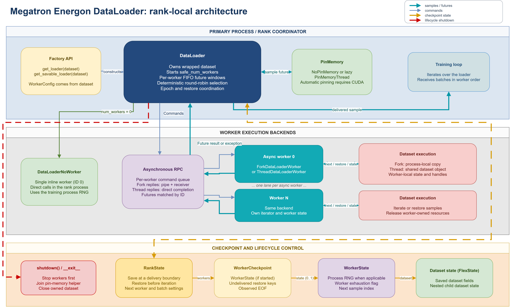
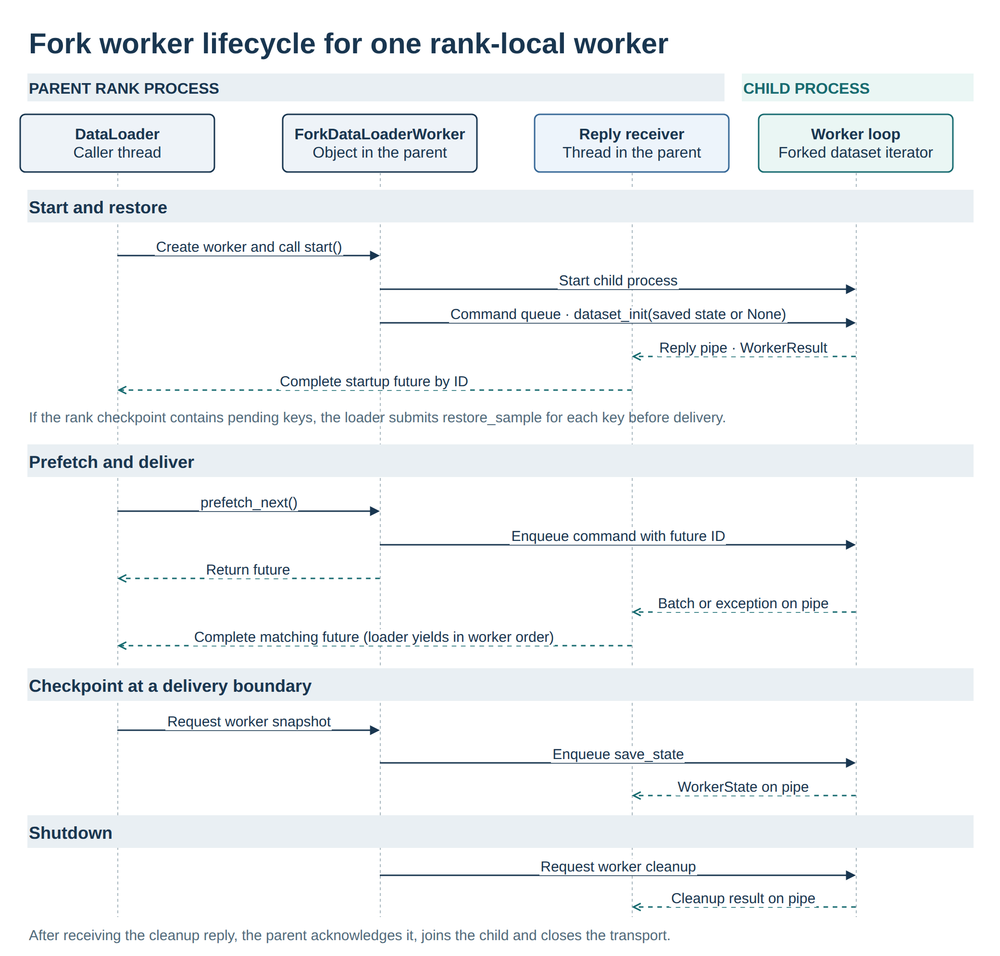
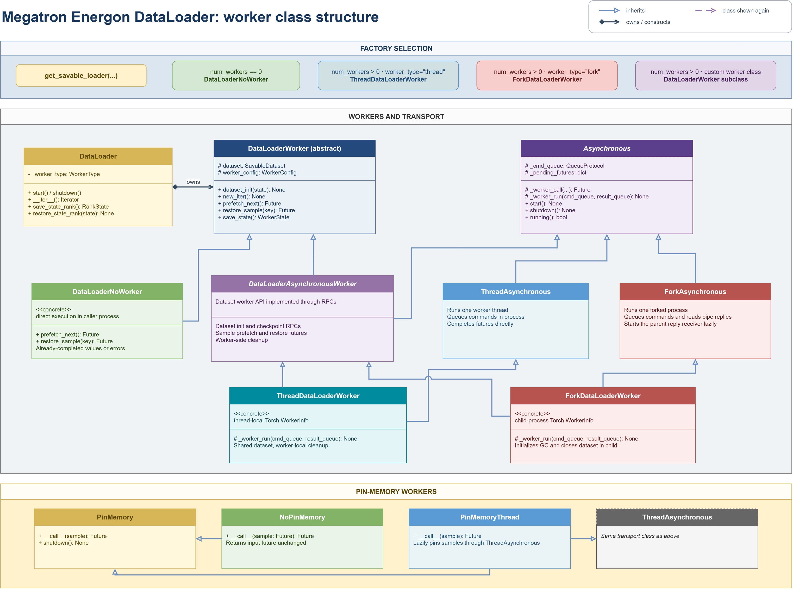

<!--- Copyright (c) 2025, NVIDIA CORPORATION.
SPDX-License-Identifier: BSD-3-Clause -->

# DataLoader Internals

This page describes the custom Megatron Energon `DataLoader` for developers working on worker
execution, deterministic checkpointing, prefetch, or lifecycle behavior. It describes the current
implementation in `src/megatron/energon/dataloader` and the factory functions in
`src/megatron/energon/loader.py`.



The editable source for the diagram is
{download}`dataloader.drawio <../images/dataloader.drawio>`.

## Responsibilities and Boundaries

One `DataLoader` coordinates one rank. Dataset sharding across ranks and workers is already encoded
in the dataset's `WorkerConfig`; the loader does not repartition samples itself. Its responsibilities
are:

- select and start the worker backend;
- maintain a bounded prefetch window for every rank-local worker;
- interleave workers deterministically;
- optionally pin returned samples in the primary process;
- capture worker state plus already-prefetched samples;
- route restore keys back to the worker that produced them; and
- shut down workers, queues, helper threads, and the owned dataset.

The loader takes ownership of its dataset. A dataset passed to a loader must not be shared with
another live loader.

## Construction

`get_loader()` and `get_savable_loader()` both construct the custom `DataLoader`. The latter exposes
additional worker-backend, garbage-collection, cache-pool, pin-memory, and compatibility options.

The factory derives the effective execution mode from `WorkerConfig.num_workers`:

| Configuration | Worker implementation | Execution location |
| --- | --- | --- |
| `num_workers == 0` | `DataLoaderNoWorker` | Calling process |
| `num_workers > 0`, `worker_type="fork"` (default) | `ForkDataLoaderWorker` | One forked process per worker |
| `num_workers > 0`, `worker_type="thread"` | `ThreadDataLoaderWorker` | One thread per worker |

The loader wraps the dataset with `WatchdogDataset` and `GcDataset` when those features are enabled.
For worker-backed loaders, automatic pinning creates a lazy `PinMemoryThread` when CUDA is available.
The pinning thread starts only when its first future is submitted.

## Lifecycle

Construction does not start workers. Workers start in either of two ways:

1. `DataLoader.__enter__()` calls `start()` immediately.
2. Iteration calls `start()` lazily when the first epoch iterator runs.

`start()` creates `safe_num_workers` worker objects, starts their execution backend, and calls
`dataset_init()` in each worker. A pending restore state is applied during this initialization.
If startup fails, the loader rolls back the workers it already started.

Use the loader as a context manager whenever possible:

```python
with get_loader(dataset) as loader:
    for batch in loader:
        train_step(batch)
```

Stage the rank checkpoint before entering the context so the workers apply it on startup.

```python
loader = get_savable_loader(dataset)
loader.restore_state_rank(state)

with loader:
    for batch in loader:
        train_step(batch)
```

`shutdown()` cancels queued prefetch and requests cleanup from all workers under one deadline.
The built-in workers have 15 seconds by default to finish in-flight work and clean up.
Pass `worker_shutdown_timeout` to either loader factory to adjust that grace period.
Workers acknowledge after
releasing their resources, and cleanup errors reach the caller. The loader reaps fork workers
before joining the pin-memory helper, which may be waiting on their replies. It then closes the
owned dataset. Blocked fork workers are terminated when their grace period expires. A blocked
thread worker reports a timeout and retains ownership until it exits, because Python cannot
safely terminate a running thread. `__del__()` is an emergency fallback.

### Fork Lifecycle Call Flow



The editable source for the flow diagram is
{download}`dataloader_fork_flow.drawio <../images/dataloader_fork_flow.drawio>`.

The worker-process lifeline represents each rank-local fork worker; those processes execute in
parallel with independent command queues and reply pipes. Solid teal messages are commands submitted by
`_worker_call()`, while dashed teal messages are `WorkerResult` values matched to `FutureImpl`
instances by `future_id`. The flow also highlights that checkpoint state is staged before workers
start, then applied through RPC when `start()` initializes each worker and reconstructs saved
prefetched samples.

## Steady-State Iteration

The rank coordinator keeps one FIFO list of sample futures per worker. At the start of an epoch it
fills every list to `prefetch_factor`. It then repeats the following sequence:

1. Select `_next_worker_id` and advance it round-robin.
2. Skip workers already marked exhausted.
3. Pop the oldest future for the selected worker.
4. Submit another `prefetch_next()` command to refill that worker's window.
5. Resolve the popped future, waiting only if its result is not ready.
6. Yield the sample and update rank-local debug counters.

This gives deterministic worker interleaving even when worker completion times differ. Results may
arrive out of order. The transport matches each reply by `future_id` and completes its future.
Callers wait on their own futures independently.

When every worker returns `StopIteration`, the epoch ends. The next epoch calls `new_iter()` on all
workers, clears the exhausted flags, and resets round-robin selection to worker 0.

## Worker Execution

`DataLoaderWorker` contains the backend-independent dataset logic:

- initialize or restore the dataset and RNG;
- create the dataset iterator;
- fetch the next sample;
- wrap its restore key with a `WorkerSampleRestoreKey`; and
- save `WorkerState`.

### Implementation Classes



The editable source for the class diagram is
{download}`dataloader_classes.drawio <../images/dataloader_classes.drawio>`.

The asynchronous implementations use multiple inheritance. `DataLoaderAsynchronousWorker`
combines the dataset-facing `DataLoaderWorker` API with the `Asynchronous` command/future
mechanism. `ThreadDataLoaderWorker` then adds `ThreadAsynchronous`, while
`ForkDataLoaderWorker` adds `ForkAsynchronous`. With zero workers, `DataLoaderNoWorker` runs
the shared dataset operations directly in the calling process.

The related pin-memory hierarchy follows the same pattern. `NoPinMemory` returns the input future
unchanged,
while `PinMemoryThread` combines `PinMemory` with `ThreadAsynchronous` and starts its helper thread
lazily on the first sample.

`DataLoaderAsynchronousWorker` adapts those operations to commands and futures. Each command contains
a method name, arguments, and a `future_id`. The worker loop executes the method and returns either a
result or an exception tagged with the same ID.

The process backend serializes commands before enqueueing them and sends replies synchronously over
a pipe whose only writer is the child. Fork launches are serialized so another loader cannot inherit
the reply writer. A receiver thread decodes fork replies and settles futures. Its decoding work is
outside the caller's shutdown deadline. If decoding is stuck, shutdown cancels the futures, stops
the child, and reports a timeout. The receiver can exit when the decoder returns.

The process backend installs worker signal handlers, limits Torch to one thread in each child, and
monitors the parent process. The thread backend queues commands and completes futures directly
from the worker thread. It uses thread-local worker information. Call `torch.utils.data.get_worker_info()` through the module in thread workers.
References imported before Energon use PyTorch's original process-local implementation.

## Checkpoint State

`save_state_rank()` captures all information needed to continue the same rank-local stream:

- one record per worker with its execution snapshot, keys for undelivered prefetched samples,
  and whether the loader observed EOF;
- the next worker selected by round-robin interleaving; and
- the batch settings used to validate restore.

A checkpoint waits for any in-flight `next()` to record delivery. The loader takes the checkpoint
at that boundary before the next advance.

Each `WorkerState` contains the worker RNG state, recursive dataset state, exhaustion flag, and next
sample index. That index includes work completed during prefetch. The loader's delivery cursor and
the pending restore keys identify the outputs the caller still needs to receive.
Access to `TaskEncoder.rng` requires a transform decorated with
`@stateless(restore_task_encoder_seeds=True)`. The property raises outside that scope.
The seed combines the global worker seed with the worker-local invocation index, so a replayed
invocation makes the same random choices when the same workers are regrouped across ranks.
`current_sample_index` still describes rank-local interleaving.

`restore_state_rank()` only records the state. Actual restoration happens later in `start()`:

1. Worker dataset and RNG states are restored through `dataset_init()`.
2. Prefetched samples are reconstructed from their restore keys.
3. Round-robin and exhaustion metadata are restored.
4. The pending restore state is cleared.

If the restored loader uses a smaller micro-batch size that divides the saved size, it
splits pending batch keys into chunks of the target size while preserving their wrapper
structure. A short final chunk is kept unless the target loader drops incomplete batches.
Checkpoint redistribution keeps short final chunks because it has no target recipe.
Resizing with pending generator batches is rejected because the output index refers to
the original batch.

## Sample Restore Keys

For a restorable sample, `WorkerSampleRestoreKey` records the global worker ID and worker-local
sample index around the dataset's own restore key. `restore_sample()` maps that global worker ID
back to a rank-local worker and executes the underlying dataset restore operation in that worker's
context.

Restore keys are part of the deterministic data-stream contract. Changes to wrapper nesting, worker
mapping, batching, or sample-key semantics require compatibility tests for both checkpoint restore
and direct sample restore.

## Change Checklist

When modifying the loader, verify at least the following:

- the same seed and configuration produce the same yielded order;
- checkpoint restore reproduces both consumed and prefetched samples;
- interrupted iteration continues the existing epoch iterator;
- all worker backends propagate results and exceptions identically;
- `num_workers == 0` remains a supported non-process path;
- smaller compatible micro-batches restore through batch-key splitting;
- context exit and explicit `shutdown()` leave no workers or helper threads alive; and
- a restored loader resumes at the next undelivered sample on its rank.
